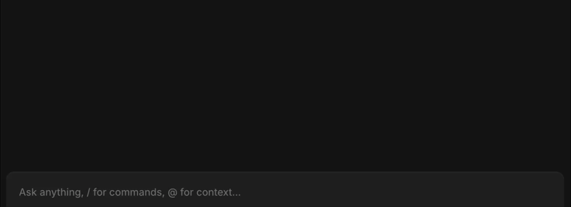

# opencode-dictation

Local voice dictation for the [OpenCode](https://opencode.ai) Desktop app on macOS.



- No audio leaves the machine.
- Works with any [whisper.cpp](https://github.com/ggml-org/whisper.cpp) model.
- Push-to-talk and auto-send options.
- Desktop app only. It does not run in the terminal UI.

## Requirements

- macOS, OpenCode Desktop 2.2.5 or later
- whisper.cpp:

```bash
brew install whisper-cpp
```

## Install

```bash
opencode plugin add github:qonto/opencode-dictation
```

Then restart Desktop.

## Usage

Press `⌘D` to start recording, and again to stop. The transcript goes into the
prompt. Change the key in **Settings → Shortcuts**.

## Settings

Open **Settings → Dictation**.

| Setting            | Default               | What it does                                                                                                                         |
| ------------------ | --------------------- | ------------------------------------------------------------------------------------------------------------------------------------ |
| Push-to-talk       | Off                   | Hold the shortcut while you talk, and let go to stop. Off: press once to start, once to stop.                                        |
| Send automatically | Off                   | Send the transcript as soon as it is ready.                                                                                          |
| Language           | `en`                  | A whisper language code such as `fr`, or `auto` to detect it (adds a short delay).                                                   |
| Model              | `large-v3-turbo-q5_0` | Any [whisper.cpp model](https://huggingface.co/ggerganov/whisper.cpp/tree/main), without `ggml-` and `.bin`. Downloads on first use. |
